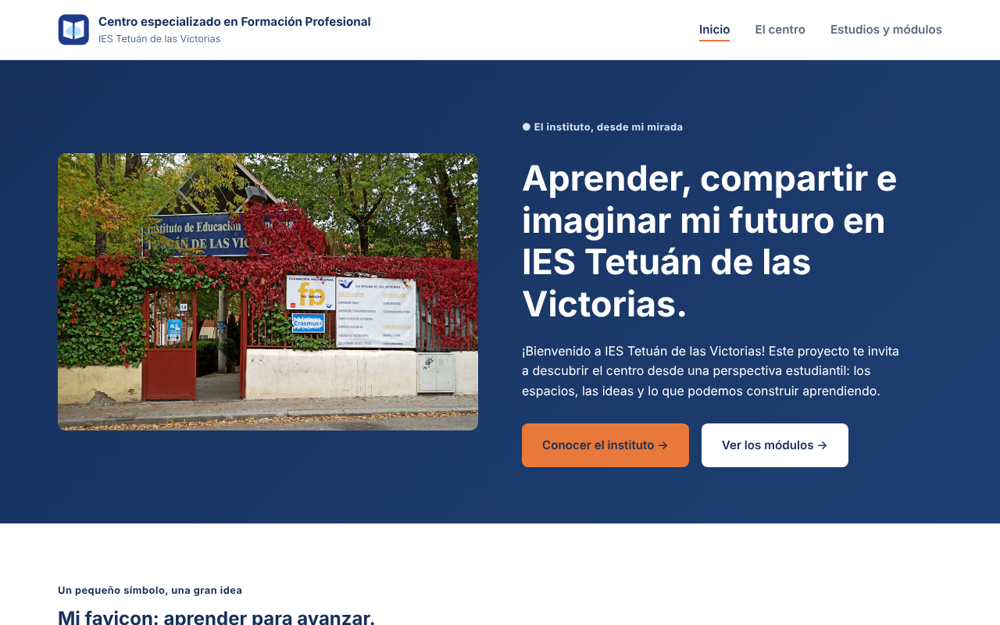

# 🏫 IES Tetuán de las Victorias — Web del centro

Sitio web multipágina y responsive que presenta el IES Tetuán de las Victorias desde la mirada de un estudiante: el centro, sus espacios y los estudios de FP que ofrece.

> Proyecto del módulo **Diseño de Interfaces Web** (2º DAW).

🔗 **Demo:** https://3r4yn.github.io/ies-tetuan-web/ies-tetuan/




---

## 🎯 Problema que resuelve

Las webs institucionales suelen ser densas y poco orientadas al alumnado. Esta propuesta reorganiza la información en tres páginas claras (Inicio, El centro, Estudios y módulos) con una jerarquía visual pensada para quien está decidiendo qué estudiar.

## 🛠️ Stack

| Capa | Tecnología |
|------|------------|
| Maquetación | HTML5 semántico (`header`, `nav`, `main`, `section`) |
| Estilos | CSS3 (Flexbox / Grid, media queries) |
| Tipografía | Google Fonts: Inter + Manrope |
| Despliegue | GitHub Pages |

## 📁 Estructura

```
ies-tetuan/
├── index.html       # Portada
├── centro.html      # Información del centro
├── estudios.html    # Ciclos y módulos
├── css/style.css
└── img/             # Imágenes, favicons e iconos 192/512 px
```

## 🚀 Ejecutar en local

```bash
git clone https://github.com/3r4yn/ies-tetuan-web.git
cd ies-tetuan-web/ies-tetuan
# Abre index.html en el navegador o usa la extensión Live Server de VS Code
```

## 🧠 Decisiones técnicas

- **Nomenclatura tipo BEM** (`primeraseccion__imagen`, `boton--principal`) para que los estilos sean predecibles y no se pisen entre secciones.
- **Accesibilidad:** `aria-label` en la navegación, `aria-current="page"` en el enlace activo y textos `alt` descriptivos.
- **Favicons en varios tamaños** e iconos de 192/512 px, preparados para instalar la web como PWA.
- **Responsive:** un único breakpoint a 860 px; por debajo, la navegación se oculta tras el botón de menú y las secciones pasan a una sola columna.

## 🔜 Próximas mejoras

- [ ] Hacer funcional el botón de menú móvil con JavaScript
- [ ] Puntuación Lighthouse > 90 en accesibilidad y rendimiento
- [ ] Optimizar imágenes a WebP

## 👤 Autor

**Brayan** — Estudiante de 2º DAW · [GitHub](https://github.com/3r4yn) · [LinkedIn](https://www.linkedin.com/in/brayan-reatiqu%C3%AD-arequipa-5b48373a0/)
